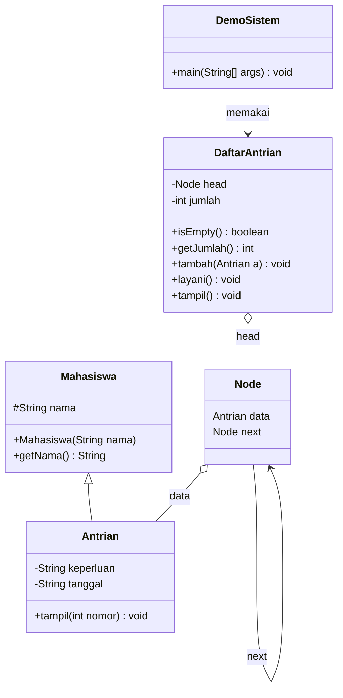

<div align="center">

# 🎓 Sistem Layanan Antrian Akademik Kampus

**Studi kasus penerapan _ADT_, _Inheritance_, dan _LinkedList_ dengan Java**


_Tugas Proyek Kelompok **Bismikaallah** · Algoritma dan Struktur Data · Universitas Mataram_

</div>

---

## 📑 Daftar Isi

- [Tentang Proyek](#-tentang-proyek)
- [Fitur](#-fitur)
- [Konsep yang Diterapkan](#-konsep-yang-diterapkan)
- [Struktur Proyek](#-struktur-proyek)
- [Diagram Kelas](#-diagram-kelas)
- [Ilustrasi LinkedList](#-ilustrasi-linkedlist)
- [Cara Menjalankan](#-cara-menjalankan)
- [Contoh Tampilan Program](#-contoh-tampilan-program)
- [Penjelasan Kode](#-penjelasan-kode)
- [Kompleksitas Operasi](#-kompleksitas-operasi)
- [Tim Pengembang](#-tim-pengembang)
- [Pengembangan Selanjutnya](#-pengembangan-selanjutnya)

---

## 📌 Tentang Proyek

Mahasiswa antre di bagian akademik kampus untuk **konsultasi KRS**, **legalisir ijazah**, atau **bimbingan skripsi**.
Aturannya **FIFO** (_First In First Out_): yang datang lebih dulu, dilayani lebih dulu.

Setiap mahasiswa dicatat dengan **3 data**:

| Variabel | Isi | Contoh |
|---|---|---|
| 1 | `nama` | Bowo |
| 2 | `keperluan` | Konsultasi KRS |
| 3 | `tanggal` | 20-10-2026 |

Program berjalan di terminal dengan **menu interaktif** dan memakai struktur data **LinkedList buatan sendiri** (tanpa `java.util.LinkedList`).

## ✨ Fitur

- ➕ **Tambah antrian**: mahasiswa baru masuk di urutan paling belakang
- 📋 **Tampilkan antrian**: menelusuri seluruh antrian dari depan sampai belakang
- 🙋 **Layani antrian**: mahasiswa paling depan dilayani lalu keluar dari antrian
- 🚪 **Keluar**: menutup program
- 🛡️ Penanganan antrian kosong dan pilihan menu yang tidak valid

## 🧠 Konsep yang Diterapkan

| Konsep | Diterapkan pada | Penjelasan singkat |
|---|---|---|
| **Inheritance** | `Mahasiswa` → `Antrian` | `Antrian` mewarisi `nama` dari `Mahasiswa` (`extends` dan `super`), lalu menambah `keperluan` dan `tanggal` |
| **LinkedList** | `Node` | Satu mata rantai berisi data `Antrian` dan penunjuk `next` ke node berikutnya |
| **ADT** | `DaftarAntrian` | Data (`head`, `jumlah`) bersifat `private`. Pengguna hanya memakai operasi `tambah()`, `layani()`, `tampil()` |

## 🗂️ Struktur Proyek

```text
sistem-antrian-akademik-kampus/
├── src/
│   ├── Mahasiswa.java       # Kelas induk (Inheritance)
│   ├── Antrian.java         # Kelas anak (Inheritance)
│   ├── Node.java            # Satu mata rantai (LinkedList)
│   ├── DaftarAntrian.java   # ADT antrian berbasis LinkedList
│   └── DemoSistem.java      # Program utama (menu input)
├── .gitignore
└── README.md
```

## 🏗️ Diagram Kelas



## 🔗 Ilustrasi LinkedList

```text
head
  │
  ▼
┌────────┬──────┐     ┌────────┬──────┐     ┌────────┬──────┐
│  Bowo  │ next │────▶│ Giban  │ next │────▶│  Joko  │ next │────▶ null
└────────┴──────┘     └────────┴──────┘     └────────┴──────┘
```

- `tambah()` : telusuri sampai node terakhir, lalu sambungkan node baru di belakang
- `layani()` : `head = head.next`, node paling depan terlepas dari rantai
- `tampil()` : telusuri dari `head` sampai `null` sambil mencetak data

## 🚀 Cara Menjalankan

**Prasyarat:** JDK sudah terpasang (cek dengan `java -version` dan `javac -version`).

### Lewat VS Code

1. Clone repository ini atau unduh sebagai ZIP, lalu buka folder `src` di VS Code
2. Pasang extension **Extension Pack for Java**
3. Buka `DemoSistem.java`, lalu klik **Run** di atas method `main`
4. Ketik pilihan menu di panel **Terminal**, lalu tekan Enter

### Lewat terminal

```bash
git clone https://github.com/USERNAME/sistem-antrian-akademik-kampus.git
cd sistem-antrian-akademik-kampus/src
javac *.java
java DemoSistem
```

## 🖥️ Contoh Tampilan Program

<!-- Setelah punya tangkapan layar, simpan sebagai docs/demo.png lalu hapus tanda komentar di baris bawah -->
<!--  -->

**Menu utama**

```text
=== ANTRIAN AKADEMIK KAMPUS ===
      1. Tambah antrian
      2. Tampilkan antrian
      3. Layani antrian
      0. Keluar
      Pilih:
```

**Tambah antrian** (pilih `1`)

```text
=== ANTRIAN AKADEMIK KAMPUS ===
    Nama mahasiswa : Bowo
    Keperluan      : Konsultasi KRS
    Tanggal        : 20-10-2026

    --Berhasil ditambahkan!--
================================
```

**Tampilkan antrian** (pilih `2`)

```text
=== ANTRIAN AKADEMIK KAMPUS ===
1. Bowo | Konsultasi KRS | 20-10-2026
2. Giban | Legalisir Ijazah | 21-10-2026
3. Joko | Bimbingan Skripsi | 22-10-2026
```

**Layani antrian** (pilih `3`)

```text
=== ANTRIAN AKADEMIK KAMPUS ===
         Dilayani: Bowo
-------------------------------
```

**Keluar** (pilih `0`)

```text
================================
 Terima kasih, Antrian Selesai!
================================
```

## 📖 Penjelasan Kode

| File | Peran | Poin penting |
|---|---|---|
| `Mahasiswa.java` | Kelas induk | Menyimpan `nama` (`protected`) dan `getNama()` |
| `Antrian.java` | Kelas anak | `extends Mahasiswa`, `super(nama)`, menambah `keperluan` dan `tanggal`, method `tampil()` |
| `Node.java` | Mata rantai LinkedList | Berisi `data` (objek `Antrian`) dan `next` (penunjuk node berikutnya) |
| `DaftarAntrian.java` | ADT antrian | `head` dan `jumlah` bersifat `private`, operasi `tambah`, `layani`, `tampil`, `isEmpty`, `getJumlah` |
| `DemoSistem.java` | Program utama | `Scanner` untuk input, `do-while` untuk menu berulang, `switch` untuk memilih aksi |

## ⏱️ Kompleksitas Operasi

| Operasi | Kompleksitas waktu | Alasan |
|---|---|---|
| `tambah()` | O(n) | Harus berjalan ke node terakhir terlebih dulu |
| `layani()` | O(1) | Cukup memindahkan `head` ke node berikutnya |
| `tampil()` | O(n) | Menelusuri seluruh node |
| `isEmpty()` / `getJumlah()` | O(1) | Hanya membaca `head` atau `jumlah` |

## 👥 Tim Pengembang

**Kelompok Bismikaallah · Kelas D**

| Nama |
|---|
| Nurlaeli Hidayati (ELI) |
| Qolbina Aprianti (APRI) | 
| Neza Alya Ramdhani (ALYA) |
| Aura Iftita Ihzarani (AURA) | 

## 🔮 Pengembangan Selanjutnya

- [ ] Menambah variabel `tail` agar `tambah()` menjadi O(1)
- [ ] Validasi input menu dengan `try-catch` agar tidak error saat mengetik huruf
- [ ] Fitur mencari mahasiswa berdasarkan nama
- [ ] Fitur membatalkan antrian di tengah rantai
